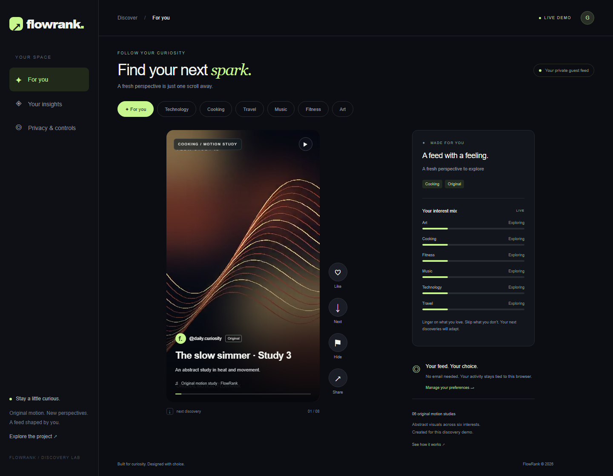
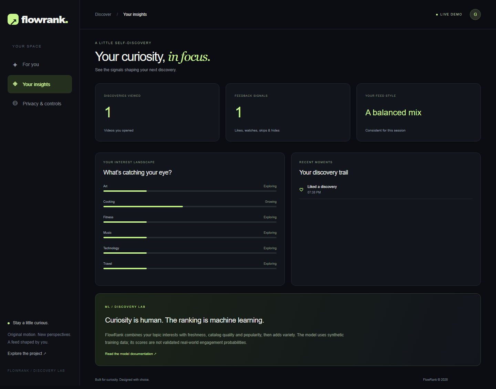
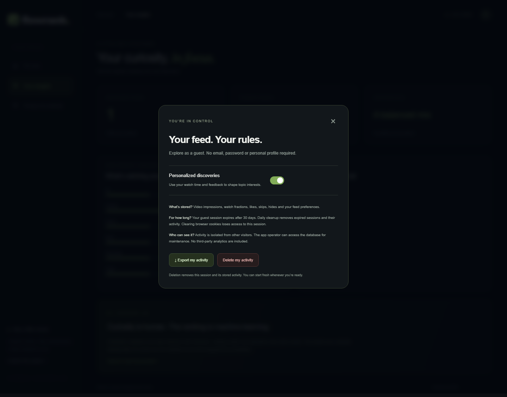
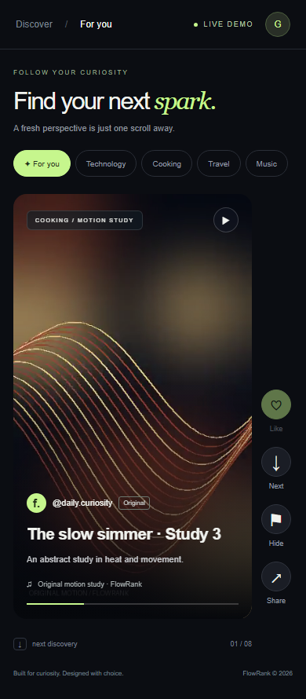
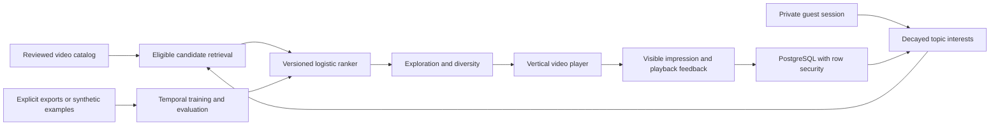

# ML — FlowRank ↗

**A short-form discovery product with machine learning ranking, playable original videos, private guest sessions and a durable feedback loop.**



**Project type: Machine Learning (ML).** FlowRank uses logistic regression for ranking, with personalized retrieval, bounded exploration and diversity reranking. It does not use deep learning or generative AI, and does not reproduce TikTok's proprietary algorithm.

## Product showcase

These are screenshots of the running application connected to PostgreSQL, captured with `npm run screenshots`—not design mockups.

### Your curiosity, in focus

See actual session impressions, feedback and your evolving interest map.



### Your feed, your rules

Turn personalization off, export your activity or delete the current session and its data.



### Discovery on mobile

The same playable feed adapts to a narrow screen, with topic chips and accessible playback actions.



## What is implemented

| Area | Implementation |
| --- | --- |
| Product | Vertical video player, topic filters, like/next/hide actions, keyboard shortcuts, responsive layout, personal insights and privacy dialog |
| Media | Six original 12-second silent motion studies, packaged MP4s and posters, CC0 media license; 24 metadata entries reuse these six studies |
| Identity | Random 256-bit guest bearer cookie; Secure in production, HttpOnly, SameSite=Lax; only token hashes stored |
| Persistence | PostgreSQL/Supabase in production; request-scoped transactions via Supavisor; SQLite for local development |
| Isolation | Private `flowrank` schema, least-privilege runtime login, forced PostgreSQL row-level security on session activity |
| Feedback | Measured visible playback fractions, explicit likes/skips/hides, exposure ownership, duplicate prevention and elapsed-time bounds |
| Recommendations | Candidate union from affinity/freshness/popularity, learned ranking, stable exploration, topic and creator diversity |
| Experiments | Stable 50/50 session assignment to balanced/diverse variants, exposure and model-feature logging |
| Privacy | Personalization opt-out, activity export, immediate cascade deletion, 30-day session expiry and protected daily retention job |
| Moderation | Pending/approved/blocked states, eligibility filters, session-specific hiding and authenticated admin metadata ingestion |
| ML lifecycle | Versioned model artifact, chronological split, log loss, NDCG@10, Recall@10, optional training on explicitly labeled exports |
| Operations | Flask WSGI/Vercel Python deployment, Waitress locally, health endpoint, request IDs, structured timings, CSP and rate limits |
| Verification | Python unit/API tests, real PostgreSQL RLS test, desktop/mobile browser tests and GitHub Actions |

The hosted demo is designed for public product evaluation. It is not a claim of production readiness for a large user-generated video platform: training data and catalog quality/popularity are synthetic, the catalog is small, and sustained load, disaster recovery and independent security audits remain future work.

## Run locally

Requires Python 3.10+; the hosted runtime uses Python 3.12. The trained model and playable media are committed, so no API key, third-party video host or training step is required for local use.

```bash
git clone https://github.com/vams2krish/ML-FlowRank.git
cd ML-FlowRank
python -m pip install -r requirements.txt
python app.py
```

Open **http://127.0.0.1:8000**. A private guest session starts automatically. Watch a clip, like it, move to the next discovery, then open **Your insights**. Refreshing preserves the session. Privacy controls are available from the guest avatar on all screen sizes.

Without `DATABASE_URL`, the application uses `data/product.db` locally. On Vercel, the app requires PostgreSQL and refuses to fall back to ephemeral storage. Environment names and descriptions are in [.env.example](.env.example). Python does not automatically load `.env.local`; supply environment variables through your terminal or hosting environment.

The original dependency-free v1 engine remains available through `python -m flowrank.server` and `python -m flowrank.train` for comparison. **Use `python app.py` for the current product.**

## How it works



1. **Start privately.** The server creates an opaque guest session. Requests cannot choose another user's ID. Guests are browser-bound, not email/password accounts.
2. **Filter eligible content.** Only approved videos enter the feed. Reported items stay hidden for that guest; recently watched/skipped items are excluded for 30 minutes.
3. **Build interests.** Likes contribute +1, skips −0.6, hides −2, and watches `2 × fraction − 0.5`. Contributions decay with a seven-day time constant, are limited to the session's retention window and pass through `tanh(total / 3)`. Opting out zeros these features.
4. **Retrieve and rank.** Union up to 40 items each from affinity, freshness and popularity, then rank from four features: affinity, quality, freshness and popularity. This reference implementation scans a small indexed catalog; it does not claim an ANN retrieval service.
5. **Add variety.** A stable exploration bonus is bounded at 0.06. Greedy reranking penalizes repeated topics by 0.07 or 0.17 depending on the experiment variant, and repeated creators by 0.04.
6. **Measure the experience.** Opening a displayed card logs an impression, its features, score and experiment assignment. Playback accumulates only while visible and playing; the server also caps the fraction by elapsed time. Client signals remain untrusted measurements, not verified attention.
7. **Learn within the session.** Feedback immediately updates the interest map; the next retrieved batch uses those interests. Model weights change only through a reviewed training/deployment step.

## Model and evaluation

Reproduce the shipped model:

```bash
python -m scripts.train_product
```

The synthetic evaluation has 300 query groups of 20 candidates. The first 240 groups train the model and the last 60 groups form the holdout. Query groups do not cross partitions. Time ordering is simulated; these results do not measure real distribution shift.

| Metric | FlowRank | Baseline |
| --- | ---: | ---: |
| Holdout log loss ↓ | 0.4727 | 0.6915, constant training prevalence |
| NDCG@10 ↑ | 0.8404 | 0.5140, popularity ordering |
| Recall@10 ↑ | 0.7800 | 0.5054, popularity ordering |

These are **synthetic benchmark results**, not evidence of improved real-world retention or user satisfaction. See [flowrank/model.json](flowrank/model.json) for weights, bias, split and metric metadata.

To experiment with your own opted-in activity exports:

```bash
python -m scripts.train_product --exports .local/session-a.json .local/session-b.json --output .local/candidate-model.json
```

This path requires at least 100 explicitly labeled impressions, splits by timestamp and uses feature snapshots captured before feedback. Likes and sufficiently completed watches are positive; explicit skips/hides are negative. Unlabeled exposures are excluded rather than silently treated as negatives. Selection bias remains, and real-data ranking metrics are not fabricated when the exports lack proper candidate-set labels. A small demo catalog/session is insufficient to establish real model quality. Collected visitor data is not automatically used for training.

## API

All private routes use the guest cookie. Browser writes require `X-FlowRank: 1` and same-origin requests. Responses are not cached.

| Method | Endpoint | Behavior |
| --- | --- | --- |
| GET | `/health` | Runtime version and database connectivity |
| POST / GET | `/api/session` | Start guest session / read current preferences and interests |
| GET | `/api/feed?topic=All` | Ranked eligible recommendations |
| POST | `/api/impressions` | Record a displayed video and return an exposure ID |
| POST | `/api/events` | Record owned-exposure watch/like/skip/report feedback |
| PATCH | `/api/preferences` | Enable/disable personalization |
| GET | `/api/privacy/export` | Export the current session's activity and feature snapshots |
| DELETE | `/api/privacy` | Delete session and cascade-delete activity |
| GET | `/api/stats` | Current session signal count, catalog count and model metadata |
| POST | `/api/admin/catalog` | Admin-only pending metadata ingestion |
| PATCH | `/api/admin/catalog/ID` | Admin-only moderation decision |
| GET | `/api/maintenance` | Secret-protected scheduled retention cleanup |

Example feedback body:

```json
{"event_id":"unique-id","impression":"exposure-id-from-server","kind":"watch","watch":0.85}
```

Ownership is checked against the cookie-derived session, not a user ID in the payload. An impression supports one event per kind; retries do not multiply feedback. Admin media imports accept only reviewed assets already packaged with the release.

## Verify and capture product screenshots

```bash
python -m unittest discover -s tests -v
npm ci
npx playwright install chromium
# Keep python app.py running in another terminal:
npm run test:e2e
npm run screenshots
```

Set `BASE_URL` to test a deployed release. The browser suite verifies playback readiness, feedback persistence after reload, insights, opt-out, export, deletion and mobile layout. The optional direct PostgreSQL test uses `DATABASE_TEST_URL`; it is skipped when that variable is absent. The suite creates only disposable random sessions. Four screenshots are saved under `docs/screenshots/`.

## Deployment and operations

The app runs on Vercel with durable PostgreSQL in a private schema. See [the operations guide](docs/OPERATIONS.md) for provisioning, secrets, RLS, daily retention, admin ingestion, deployment/promotion, rollback and incident handling. The hosted database currently shares the existing DuetSync project under the owner's explicit authorization, with separate tables and a dedicated login.

The repository includes CI tests. Automatic Git-triggered Vercel deployments require the owner to connect GitHub to Vercel; direct CLI deployments are supported independently. Never commit `.env*`, `.local/`, database files, exported user activity or credentials.

## Project structure

```text
app.py                        Product API and production WSGI entrypoint
flowrank/store.py             SQLite/PostgreSQL transaction adapter
flowrank/recommend.py         Interests, learned ranking and reranking
flowrank/catalog.py           Reviewed demo catalog
flowrank/model.json           Versioned model and evaluation metadata
flowrank/engine.py, train.py  Original v1 educational baseline
static/                       Responsive product UI and original playable media
migrations/001_product.sql    Private schema, database role, indexes and RLS
scripts/train_product.py      Temporal training and ranking evaluation
scripts/generate_media.py     Reproducible original motion assets
scripts/screenshots.mjs       Real product showcase captures
tests/                        API, training, RLS and browser coverage
docs/                         Product screenshots and operations guide
vercel.json                   Runtime region and daily maintenance schedule
```

## Next roadmap

- Dedicated database/project, sustained load testing, backup/restore drills, alerting and explicit availability objectives.
- Real licensed catalog and upload/transcoding pipeline with object storage, moderation review tooling and abuse controls.
- Catalog-scale retrieval and caching, learned multimodal embeddings and a two-tower DL model when data supports it.
- Proper randomized item exploration with logged propensities, real temporal validation, fair exposure analysis and statistically powered experiment readouts.
- Optional permanent accounts and cross-device identity, carefully designed consent and data portability.

## License

Code: [MIT](LICENSE). Bundled original videos and posters: [CC0](static/media/LICENSE.txt).
