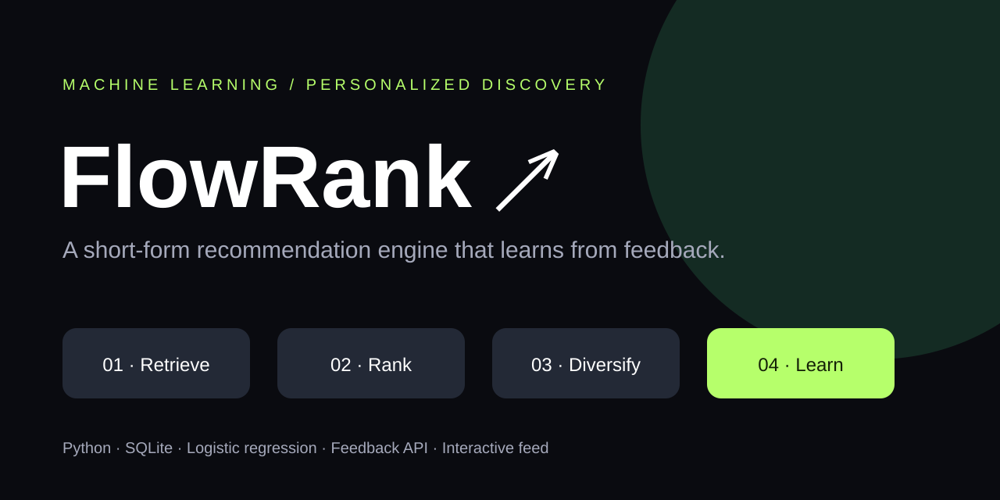
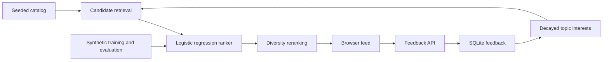

# ML — FlowRank



**An end-to-end educational machine learning recommendation system inspired by short-form video discovery.** FlowRank connects catalog ingestion, user feedback, interest features, candidate retrieval, learned ranking, diversity, persistence, evaluation, a JSON API, and an interactive browser demo.

**Project type: ML (Machine Learning).** The trainable model is logistic regression implemented in Python. This project does not use deep learning or generative AI. It is an independent demonstration, not TikTok's proprietary algorithm.

## Run locally

Requires Python 3.10 or newer. No third-party packages, API keys, downloads, or paid services are needed.

```bash
git clone https://github.com/vams2krish/ML-FlowRank.git
cd ML-FlowRank
python -m flowrank.train
python -m flowrank.server
```

Open **http://127.0.0.1:8000**. Change the user ID to explore cold starts and separate profiles. Like, skip, or mark a card watched to update the profile and refresh recommendations. The catalog contains 120 seeded metadata items across six topics. Cards are illustrations, not actual playable videos. The watched button simulates a completed watch.

## How it works



1. **Catalog:** a reproducible seed creates metadata with topics, creators, durations, quality, freshness, and popularity. Those quality and popularity values are synthetic and static.
2. **Feedback:** event IDs provide retry deduplication. SQLite stores user, item, event type, watch fraction, and time. Seen items are excluded from subsequent recommendations for that user.
3. **Interest profile:** likes contribute +1; skips −1; watches contribute `2 × watch_fraction − 0.5`. Contributions decay exponentially with a seven-day time constant, then pass through `tanh(total / 3)`.
4. **Retrieval:** union the top 40 unseen candidates from interest affinity, popularity, and freshness. This is an in-memory reference implementation, not an approximate nearest-neighbor index.
5. **Ranking:** predict synthetic engagement probability from topic affinity, quality, freshness, and popularity. A heuristic fallback works before training.
6. **Diversity:** greedily select the next item using predicted score minus `0.18 × already_selected_topic_count`.
7. **Feedback loop:** incoming events immediately update interest features. Model weights remain fixed until an explicit training run; the bundled trainer uses synthetic samples, not collected feedback.

## Training and evaluation

```bash
python -m flowrank.train
python -m unittest discover -s tests -v
```

Training generates 6,000 deterministic synthetic labeled examples, splits 4,800/1,200 into disjoint training and test partitions, and learns four weights plus a bias with stochastic gradient descent and weight regularization. It saves the model and held-out log loss alongside a constant-prevalence baseline in SQLite. Lower log loss is better. Tests verify the learned model beats that baseline on the synthetic holdout.

**These metrics measure recovery of a synthetic data-generating process. They do not demonstrate real user engagement, unbiased recommendation quality, or production readiness.** Restart the server after retraining to load the saved model.

## API

| Method | Endpoint | Behavior |
| --- | --- | --- |
| GET | `/health` | Process health |
| GET | `/api/feed?user=demo` | Up to 12 unseen ranked items and topic interests |
| GET | `/api/stats` | Catalog count, feedback count, model metadata |
| POST | `/api/events` | Validate and persist an idempotent event |

Example event body:

```json
{"event_id":"unique-client-event-id","user":"demo","video":1,"kind":"watch","watch":0.85}
```

`kind` accepts `watch`, `like`, or `skip`; `watch` must be a finite fraction from 0 to 1. User IDs must contain 1–80 characters and event IDs 1–100. Unknown videos and malformed bodies return HTTP 400. Use a new globally unique event ID for every distinct interaction. Duplicate IDs preserve the first event.

## Project structure

```text
flowrank/engine.py       SQLite schema, catalog, profiles, retrieval, ranking
flowrank/train.py        Synthetic dataset, training, evaluation, persistence
flowrank/server.py       Local HTTP server and JSON routes
static/index.html       Responsive interactive discovery interface
tests/test_system.py    Ranking, feedback, training, and HTTP integration tests
docs/project-banner.svg Original project illustration
.github/workflows/      Automated test workflow
```

## Scope and production roadmap

This local prototype binds to loopback and uses Python's single-process development HTTP server. There is no authentication, upload/transcoding pipeline, content moderation, video hosting, distributed feature store, or production deployment. User IDs are demonstration identifiers. SQLite data is local and excluded from Git.

For real deployment, add authenticated event attribution, impression and exposure logging, privacy controls and retention, moderation eligibility filters, real catalog ingestion, time-based training splits, offline ranking metrics such as NDCG/Recall, bias-aware negative sampling, an online experiment framework, observability, a scalable retrieval index, and a production API server. Consider a two-tower deep learning retrieval model only when data and scale justify it. Balance engagement with user controls, creator diversity, and well-being measures.

## License

MIT. See [LICENSE](LICENSE).
